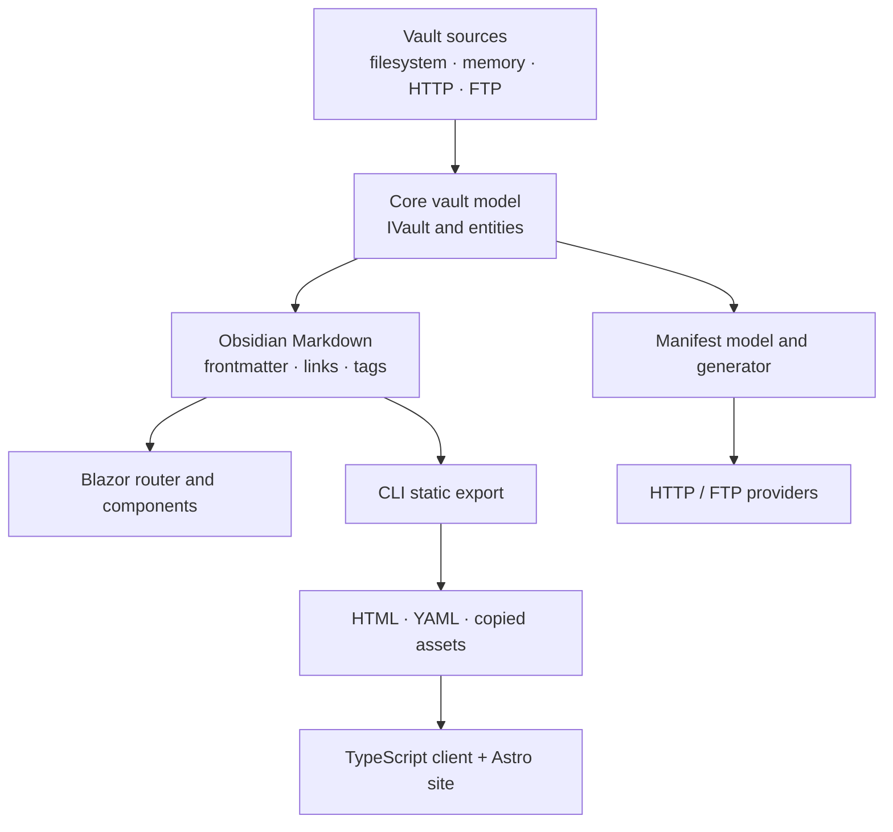
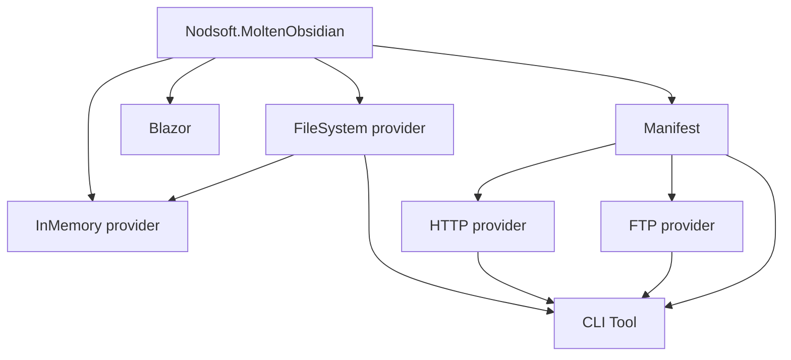
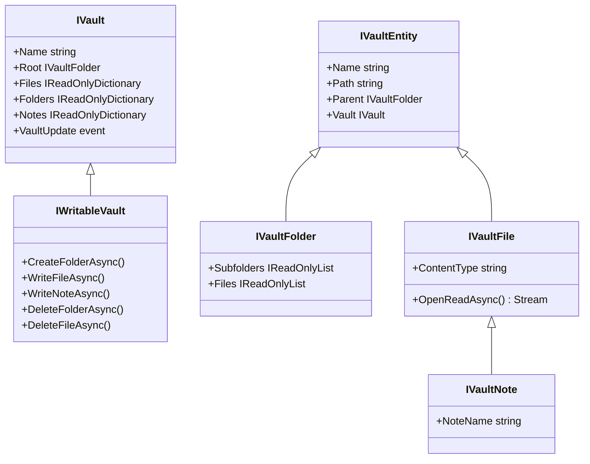
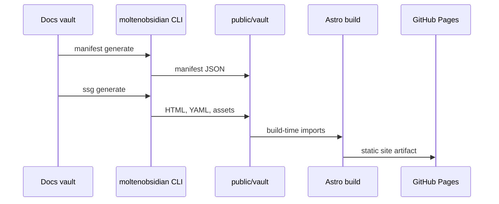

# MoltenObsidian architecture

## Purpose and scope

MoltenObsidian turns Obsidian-flavoured Markdown and vault structures into reusable .NET abstractions. Applications can read or edit vaults through interchangeable providers, render them in Blazor, publish them through a manifest, or export static assets for an Astro site.

This document describes the architecture at commit `1b62fc9` on `main` (2026-04-11). It focuses on contributor-facing boundaries and invariants rather than duplicating the public API reference.

## System context

The arrows identify dependency or data-flow direction. The core project has no dependency on providers, Blazor, the CLI, or the website.

## Build and package graph

All library packages inherit `net8.0;net10.0`, nullable context, implicit usings, latest C# language level, deterministic builds, XML documentation, and packaging metadata from `Directory.Build.props`. The manifest project opts into preview language features. The tool explicitly repeats its framework targets because it is packaged as a .NET tool.

The TypeScript projects are separate:

- `moltenobsidian-ssg-client` models and routes manifest entries.
- `nodsoft_moltenobsidian_web` links that client locally and uses it at Astro build time.

Neither is part of `Nodsoft.MoltenObsidian.slnx` or the normal .NET build workflow.

## Core document pipeline

### `ObsidianText`

`ObsidianText` is an immutable record struct holding:

- Markdown body text;
- YAML frontmatter as `Dictionary<string, object>`;
- an optional source `IVaultNote`, retained privately to provide vault context during conversion.

Construction performs this sequence:

1. Return an empty value for null/empty input.
2. Remove a leading BOM.
3. Split lines across CRLF, CR, or LF.
4. Recognize YAML only when the first line is exactly `---` and a later delimiter exists.
5. Deserialize frontmatter with YamlDotNet’s camel-case naming convention.
6. Retain the remaining Markdown body.

Invalid YAML propagates `YamlException`. New frontmatter features should not silently suppress malformed input unless the API contract is intentionally changed.

### Markdig conversion

`ObsidianHtmlConverter` wraps a built `MarkdownPipeline`. The default converter uses `ObsidianPipelineBuilder(true)`, enabling:

- Markdig advanced extensions;
- Obsidian wikilinks;
- Obsidian tags;
- syntax highlighting;
- Bootstrap-oriented output.

When an `ObsidianText` came from an `IVaultNote`, conversion adds that note to Markdig’s parser context under `currentFile`. The internal-link parser requires that context: a syntactically valid wikilink that cannot resolve in the current vault is left for other parsing rather than emitted as a resolved internal link.

### Wikilink resolution

Supported shapes include `[[note]]`, `[[note#section]]`, `[[note|display]]`, and `[[note#section|display|tooltip]]`.

Resolution rules are:

1. `[[#section]]` targets the current note.
2. `[[/path]]` uses a root-relative vault path.
3. A single unqualified name searches the current folder, then ancestors, then descendants, then descendants of the root.
4. A multi-segment path falls back to exact lookup in the vault file dictionary.

Folder-qualified relative traversal is not implemented; `VaultExtensions.ResolveRelativeLink` contains the explicit TODO. Link output strips `.md` and normalizes section text to a lowercase fragment.

### Tags

The tag inline parser activates on `#` after whitespace, excludes headings, accepts letters, digits, `_`, `/`, and `-`, and rejects all-numeric tags. The HTML renderer emits a `span.tag.moltenobsidian-tag` with a lowercase `data-name`.

## Vault domain model

### Identity and paths

- Entity paths are relative to the root and normalized to `/`.
- The root path is `""`.
- File/note dictionary keys include the extension.
- Folder dictionaries exclude the root; `GetFolder(null)` and `GetFolder("")` return `Root`.
- Filesystem `GetFile` adds `.md` when the caller omitted an extension; the base interface performs exact lookup.

Code that mutates a vault must update two representations: global dictionaries and folder-local child lists. Tests should assert both.

### Update events

`VaultUpdateEventArgs` carries `Add`, `Remove`, `Update`, or `Move` and derives `Folder`, `Note`, or `File` from the entity type. The Blazor router listens for events and rebuilds its route table for structural changes; content-only `Update` events leave routes intact.

The filesystem and in-memory providers raise events. HTTP and FTP declare the interface event but currently build immutable trees and never raise it.

## Provider implementations

| Provider | Writable | Structure source | Content source | Refresh/change model |
| --- | --- | --- | --- | --- |
| Filesystem | Yes | Recursive directory scan | `FileStream` | `FileSystemWatcher`; update events with a 100 ms file-change debounce |
| In-memory | Yes | Runtime operations | Nameless `MemoryMappedFile` | Synchronous index mutations plus async events; `Setup` suppresses events |
| HTTP | No | Remote manifest | `HttpClient.GetStreamAsync` | Immutable after construction |
| FTP | No | Remote manifest | FluentFTP stream | Immutable after construction; reconnect-on-read helper |

### Filesystem provider

`FileSystemVault.FromDirectory` validates the root, builds folder/file objects recursively, filters default ignored names into its dictionaries, identifies `.md` notes, then starts a recursive watcher.

Default ignored folders: `.obsidian`, `.git`, `.vs`, `.vscode`, and `node_modules`.

Default ignored files: `.DS_Store` and `moltenobsidian.manifest.json`.

Writes create missing parents and use `FileMode.Create`. Deletes update dictionary and parent-child state before/after removing the physical object. File watcher callbacks bridge native synchronous events into the async vault event delegate.

Contributor watchpoints:

- Native watcher events can be duplicated or reordered.
- Rename handling must update notes as well as files/folders and preserve entity identity coherently.
- Ignore rules affect the global indexes, manifest generation, and UI expectations.
- Platform path separators must be normalized before becoming vault identities.

### In-memory provider

Each file stores bytes in a nameless memory-mapped file sized to at least one byte. `OpenReadAsync` returns a view limited to the original content length. Deletion disposes the mapping and removes the folder child reference.

`Setup=true` permits bulk population without update events. When changing replacement semantics, verify that old mappings are disposed and parent lists do not accumulate duplicate entries.

The provider currently references both the manifest and filesystem projects, partly for shared MIME behavior/project structure. Avoid further coupling unless it belongs in a shared abstraction.

### HTTP and FTP providers

Both consume `RemoteVaultManifest`, create folder objects on demand while iterating manifest paths, create note subtypes for Markdown, and hold the client used to fetch content lazily.

They are intentionally read-only and have no manifest refresh. A refresh feature would need to define tree replacement, entity identity, client lifetime, cache behavior, update events, and concurrent reads; it is not a small provider-local change.

## Manifest subsystem

`RemoteVaultManifest` contains a vault name and ordered list of `ManifestFile` entries. Each file may include:

- vault-relative `path` (required);
- byte `size`;
- Base64 SHA-256 `hash`;
- MIME `contentType`;
- arbitrary metadata represented as JSON extension data.

For notes, `VaultManifestGenerator` places YAML frontmatter keys directly into the manifest file object through extension data. This flattened representation is consumed by the TypeScript client and Astro page generator, so metadata shape changes cross language and package boundaries.

When changing the manifest:

1. Update the C# records/classes.
2. Update `moltenobsidian.manifest.schema.json`.
3. Update generator and remote providers.
4. Update `nodsoft_moltenobsidian_ssg_client/vault-manifest.ts`.
5. Update routing/filtering in the client and Astro site.
6. Add compatibility tests and decide whether the change is additive or breaking.

## Blazor integration

`AddMoltenObsidianBlazorIntegration` registers a singleton `VaultRouterFactory`. The factory caches one `VaultRouter` per vault instance.

The router builds routes from:

- folders using their exact path;
- all files using the path with `.md` removed.

Lookup tries exact casing first, then a case-insensitive linear fallback. Structural vault events rebuild the table.

`ObsidianVaultDisplay` receives an `IVault`, `CurrentPath`, and `BasePath`; it resolves a route and chooses a render fragment:

1. root index note;
2. root listing;
3. folder index note;
4. folder listing;
5. note content;
6. not found.

Default templates live in `Nodsoft.MoltenObsidian.Blazor/Templates`. Consumers can replace each render fragment. `RenderNoteContent` reads a note asynchronously, raises `DocumentLoaded`, converts it, and emits `MarkupString`.

README.md or index.md is an index note case-insensitively. Frontmatter `moltenobsidian:index:enabled: false` disables index behavior for that file. Display options control root index visibility, folder navigation, and converter choice.

`OnAfterRenderAsync` updates the HTML `<base>` element through JavaScript `eval`. Changes here affect routing and browser security expectations and require bUnit/browser-level consideration.

## CLI and static export

The Spectre.Console CLI has two branches:

- `manifest generate`: scan a local filesystem vault and write `moltenobsidian.manifest.json`; optionally watch for changes.
- `ssg generate`: load a local, HTTP, or FTP vault and emit static assets; optionally generate a local manifest or watch a local source.

Static output rules:

| Input | Output |
| --- | --- |
| Markdown without frontmatter | same relative path with `.html` |
| Markdown with frontmatter | `.html` plus sibling `.yaml` |
| Other file | copied with the original extension |

The current implementation encodes generated HTML/YAML using ASCII. Treat encoding changes as user-visible behavior and add non-ASCII regression coverage.

The CLI currently has no dedicated test project. Core provider and manifest tests cover some dependencies, but command validation, remote SSG, watch mode, overwrite prompts, encoding, and path output need direct verification when changed.

## TypeScript client and Astro site

The TypeScript `VaultManifestClient`:

- loads a manifest from an object or URL;
- lazily builds routes for Markdown entries;
- honors `publish`/`moltenobsidian.publish` exclusions;
- maps README/index notes to folder routes;
- converts `.md` manifest paths to generated `.html` paths;
- parses generated YAML with the `yaml` package.

The Astro site imports the generated manifest and HTML at build time. `getStaticPaths` produces a page per route, applies publish filtering, passes manifest metadata as props, and renders generated HTML with `set:html`. The navigation tree is built from the same manifest.

The publication pipeline is:

`public/vault` is generated and ignored. Source documentation belongs under `nodsoft_moltenobsidian_web/vault`.

## CI, releases, and versioning

- `build.yml`: restore, build, and test with .NET 10 on Ubuntu, Windows, and macOS.
- `codeql.yml`: C# and JavaScript/TypeScript analysis on `main`, `develop`, pull requests, and a schedule.
- `nuget-push.yml`: calls the build workflow, packs Release packages, attests package provenance, and pushes to NuGet and GitHub Packages.
- `publish-release.yml`: creates a GitHub release for `v*` tags.
- `deploy-astro-website.yml`: generates the docs vault, installs pnpm dependencies, builds Astro with Node 22+, and deploys to GitHub Pages.

Actions are pinned to commit SHAs. Preserve this supply-chain control.

Nerdbank.GitVersioning starts from root version `1.1`; the tool overrides its base to `1.0`. Per-package path filters decide which commits affect a package version. Cross-project moves or new dependencies may require filter updates.

## Known structural gaps

These are onboarding facts, not automatic instructions to “clean up” the repository:

- The root README’s framework tagline is stale relative to build configuration.
- `Nodsoft.MoltenObsidian.slnx` omits some sample projects, including the HTTP WASM sample, and does not cover either Node project.
- `Vaults/Nodsoft.MoltenObsidian.Vaults.Embedded/EmbeddedVault.cs` and an embedded-vault sample exist without canonical solution/project integration.
- Two similarly named FTP server sample directories exist; only the plural `Samples.FtpServer` path is in the solution.
- IDE `.run` tasks use the previous `src/assets/vault` path, while current site code and CI use `public/vault`.
- The Pages workflow generates the manifest in the source vault and then exports static files to `public/vault`. The current filesystem provider excludes `moltenobsidian.manifest.json` from its index, while Astro imports that file from `public/vault`; deployment work should verify or correct this handoff. The local workflow in `docs/DEVELOPMENT.md` writes the manifest directly to the required output.
- FTP, CLI, SSG client, and end-to-end site generation have less automated coverage than core, filesystem, HTTP, in-memory, and Blazor code.

Address these through focused issues/PRs; do not mix broad repository cleanup into unrelated fixes.
